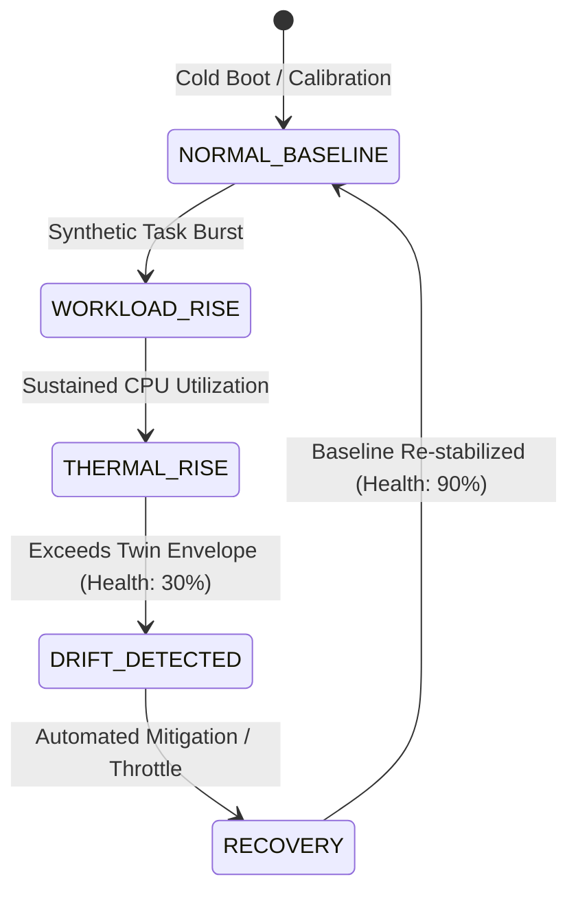

<div align="center">

# Sentinel Twin: Android Endpoint Security & Behavioral Digital Twin Framework

[](https://github.com/pkpranav-projects/Sentinel-Twin/actions/workflows/android.yml)
[](https://kotlinlang.org/)
[](https://developer.android.com/jetpack/compose)
[](https://m3.material.io/)
[](https://developer.android.com/training/data-storage/room)
[](https://developer.android.com/topic/architecture)
[](https://github.com/pkpranav-projects/Sentinel-Twin/releases/tag/v1.0.0)
[](https://opensource.org/licenses/MIT)

A proactive Android endpoint security system that creates an in-memory **Behavioral Digital Twin** of your mobile device, continuously contrasting real-time telemetry against learned operational baselines to detect stealthy zero-day deviations, privilege abuse, and persistent device drift.

[Core Concept](#-the-digital-twin-security-paradigm) • [Reasoning Engine](#-deterministic-reasoner--causal-inference) • [Demo State Machine](#-5-stage-simulation-lifecycle) • [Compose Screens](#-compose-screen-suite) • [1-Click Build](#-1-click-build--installation) • [Author](#-author)

</div>

---

## The Digital Twin Security Paradigm

Traditional mobile antivirus tools rely primarily on static signature scanning—checking if installed package names or file hashes match known malware catalogs. Sophisticated spyware, unauthorized telemetry exfiltration, and root compromises easily evade signature scanners by mutating code or abusing legitimate Android framework permissions.

**Sentinel Twin** establishes a continuous, dynamic behavioral baseline:

```text
+-------------------+        Live Telemetry        +----------------------+
|  Physical Device  | -------------------------->  | Snapshot Normalizer  |
+-------------------+                              +----------------------+
                                                              |
                                                              v
+-------------------+       Calculates Drift       +----------------------+
|   Digital Twin    | <==========================> |     Drift Engine     |
| (Learned Baseline)|                              +----------------------+
+-------------------+                                         |
                                                              v
                                                   +----------------------+
                                                   | Deterministic Reason |
                                                   |  & Evidence Builder  |
                                                   +----------------------+
```

1. **Continuous Telemetry Normalization**: Normalizes physical hardware and OS states (network sockets, battery draw curves, sensor states, package access patterns) into structured `SnapshotEntity` records.
2. **Dynamic Baseline Learning**: The `BaselineEngine` models normal operational envelopes for your specific device and user routines.
3. **Multi-Variate Drift Detection**: The `DriftEngine` measures mathematical divergence between live device states and the established digital twin.
4. **Deterministic Reasoning**: Evaluates anomalies using transparent, auditable causal rules rather than opaque AI guesses, building verifiable forensic proof chains via the `EvidenceBuilder`.

---

## Deterministic Reasoner & Causal Inference

Unlike black-box neural networks that hallucinate false positives, Sentinel Twin employs a formal **Deterministic Reasoner**:

| Observed Signal Pattern | Diagnostic Hypothesis | Causation Analysis | Engine Confidence |
| :--- | :--- | :--- | :---: |
| **Elevated Temp (> 40°C) + High Workload (> 85%)** | Uncontrolled Computational Bursts | Unusually high process execution is generating excess CPU thermal dissipation. | **HIGH** |
| **Elevated Temp (> 40°C) + Battery Charging** | Normal Exogenous Thermal Spike | Device battery charge cycle naturally elevates internal temperature envelope. | **HIGH** |
| **Elevated Temp (> 40°C) + Low Workload (< 20%)** | Stealth Background Radio Exfiltration | Suspicious hardware subsystem activity while main execution thread is dormant. | **CRITICAL** |
| **Normal Temp (< 35°C) + Normal Workload (< 30%)** | Baseline Operational Equilibrium | All physical device signals align within the learned virtual digital twin baseline. | **NOMINAL** |

---

## 5-Stage Simulation Lifecycle

Sentinel Twin features a built-in deterministic state machine (`DemoScenario.kt`) allowing researchers, hackathon judges, and auditors to verify detection pipelines without deploying real malware:



- **Stage 1 (`NORMAL_BASELINE`)**: Battery 85%, Temp 32°C, Workload 10%, Twin Health 90%.
- **Stage 2 (`WORKLOAD_RISE`)**: Battery 82%, Temp 36°C, Workload 85%.
- **Stage 3 (`THERMAL_RISE`)**: Battery 75%, Temp 41°C, Workload 90%, Severe Thermal Status.
- **Stage 4 (`DRIFT_DETECTED`)**: Battery 70%, Temp 44°C, Workload 95%, Health drops to 30%.
- **Stage 5 (`RECOVERY`)**: Battery 69%, Temp 35°C, Workload 15%, Health recovers to 90%.

---

## Compose Screen Suite

| Screen | Architectural Responsibility |
| :--- | :--- |
| **Main Dashboard** (`MainScreen`) | Real-time endpoint health gauge, overall drift percentage, quick status chips, and immediate security action recommendations. |
| **Digital Twin Explorer** (`TwinScreen`) | High-tech visual comparison rendering the live physical device status alongside its virtual digital twin counterpart. Includes Hackathon Rubric badges. |
| **Anomaly Timeline** (`TimelineScreen`) | Chronological feed of recorded telemetry snapshots, highlighting points where system parameters drifted past safety thresholds. |
| **Interactive Sandbox** (`SandboxScreen`) | An isolated testing playground allowing developers and auditors to trigger controlled parameter drifts and observe engine reactions. |
| **Forensic Investigation** (`InvestigateScreen`) | Detailed breakdown of detected security anomalies with causal evidence trails, telemetry diffs, and risk scores. |

---

## 1-Click Build & Installation

### Prerequisites
- **JDK 17+**
- **Android SDK Platform 34** (Target API 34, Min API 24)

### Automated 1-Click Build Scripts

**On Windows:**
```powershell
.\build.bat
```

**On Linux / macOS:**
```bash
chmod +x build.sh
./build.sh
```

*(Or build directly using the Gradle wrapper)*:
```bash
./gradlew assembleDebug --no-daemon
```

The compiled APK will be generated at:
`app/build/outputs/apk/debug/app-debug.apk`

### Install Directly to Connected Device via ADB
```bash
adb install -r app/build/outputs/apk/debug/app-debug.apk
```

---

## Automated CI/CD Pipeline

Every push to `master` automatically triggers the GitHub Actions workflow [`.github/workflows/android.yml`](.github/workflows/android.yml):
- Sets up JDK 17 (Temurin).
- Validates Gradle wrapper dependencies.
- Executes `./gradlew testDebugUnitTest` unit tests.
- Compiles the debug APK and uploads it as a downloadable GitHub Actions artifact.
- Automatically attaches the compiled APK to release tags (`v*`).

---

## Repository Structure

```text
Sentinel-Twin/
├── .github/
│   └── workflows/
│       └── android.yml              # Automated GitHub Actions CI & APK pipeline
├── app/
│   ├── src/main/java/com/example/sentineltwin/
│   │   ├── MainActivity.kt          # Single-activity Compose container
│   │   ├── Navigation.kt            # Compose Navigation routes and graph
│   │   ├── demo/
│   │   │   └── DemoScenario.kt      # 5-stage synthetic drift state machine
│   │   ├── device/
│   │   │   ├── Adapters.kt          # Subsystem telemetry sensors
│   │   │   └── SnapshotNormalizer.kt # Schema normalizer
│   │   ├── domain/
│   │   │   └── DomainTypes.kt       # Immutable domain data models
│   │   ├── local/
│   │   │   └── SnapshotEntity.kt    # Room database entities
│   │   ├── reasoning/
│   │   │   ├── DeterministicReasoner.kt # Causal inference logic
│   │   │   └── EvidenceBuilder.kt   # Forensic evidence DAG
│   │   ├── theme/                   # Material 3 colors, typography & shapes
│   │   ├── twin/
│   │   │   ├── BaselineEngine.kt    # Dynamic baseline learning
│   │   │   ├── DriftEngine.kt       # Telemetry delta calculation
│   │   │   └── TwinRepository.kt    # State synchronization
│   │   └── ui/                      # Jetpack Compose UI suite
│   ├── build.gradle.kts             # App dependencies & SDK definitions
│   └── AndroidManifest.xml          # Permissions & activity manifest
├── build.bat                        # 1-click Windows build script
├── build.sh                         # 1-click Linux/macOS build script
├── gradlew                          # Linux Gradle wrapper
├── gradlew.bat                      # Windows Gradle wrapper
├── make_icons.py                    # Multi-density app icon generator
├── LICENSE                          # MIT License
└── README.md                        # Framework architecture documentation
```

---

## Author

Developed by **P K PRANAV** ([@pkpranav-projects](https://github.com/pkpranav-projects)).

## License

This project is licensed under the [MIT License](LICENSE).